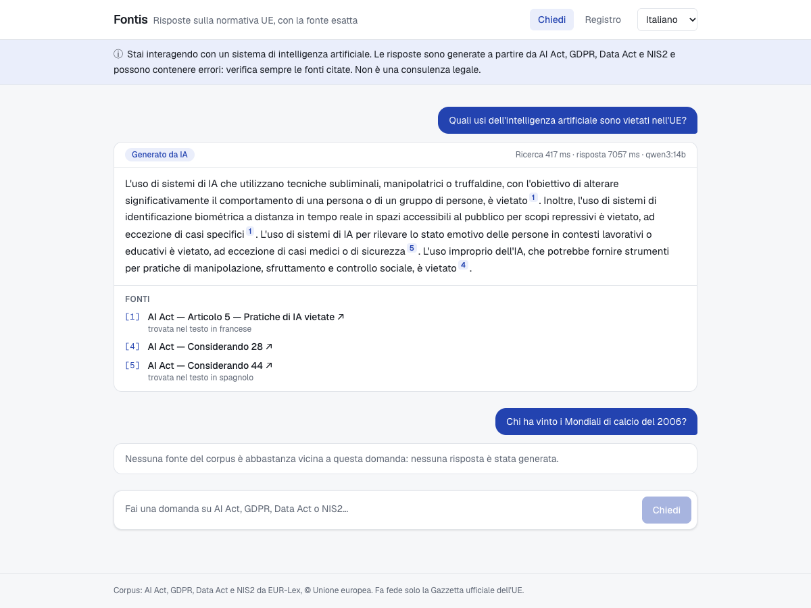

# Fontis

**EU-sovereign document AI with cited answers.** Ask questions about your organisation's documents in any
European language and get answers that cite the exact source — with data and models under your control.

> First release, v0.1.0 — see the [roadmap](docs/roadmap.md) and the [technical write-up](docs/write-up.md).



## Why

- **Cited or nothing.** Every answer points to the article, paragraph and document it comes from.
  When no source supports an answer, Fontis says so instead of guessing.
- **Multilingual by design.** Ask in Italian, find the answer in a German document, read it in Italian.
- **Sovereign.** Runs on your own servers or on EU clouds, with local open-weight models. An EU cloud
  provider (Mistral) is planned. Documents never have to leave the EU.
- **Your documents, your rules.** Upload PDFs and Word files; share each one with groups. A document a
  user may not read is filtered out inside retrieval, so it never reaches the model.
- **Built for AI Act transparency (Article 50).** AI disclosure, answer logs and visible sources are
  built in, not bolted on.
- **Measured.** A public, multilingual benchmark shows how well it works on EU law;
  measuring it on your own documents is planned.

## Benchmark

[**Fontis EU Law QA**](https://huggingface.co/datasets/Fla00/fontis-eu-law-qa), on Hugging Face:
150 questions in five languages on the AI Act, GDPR, Data Act and NIS2, 30 of which should be
refused. With `qwen3:14b` and `bge-m3` on a single RTX 3060:

| | |
|---|---|
| Gold article ranked first / in the top 5 | **78%** / 89% — 76% / 98% on the 9 base questions never used for tuning |
| Answers citing the gold article | 88% |
| Answers correct / correct or partial (LLM judge) | **64%** / 96% |
| Unanswerable questions refused | **30 / 30** |

What the benchmark found — long articles that do not fit the context, comparisons a 14B model gets
wrong, and how it shaped the ranking: [v2 findings](docs/benchmark/v2-findings.md) · [v1 findings](docs/benchmark/v1-findings.md).

## Architecture

| Part | Technology |
|---|---|
| Backend and ingestion | Java 21, Spring Boot 4, Spring AI 2, Spring Batch, Spring Security |
| Document reading | Spring AI PDF reader (pages) and Apache Tika (Word, ODT, HTML, text) |
| Retrieval | PostgreSQL 17 + pgvector, hybrid vector and full-text search |
| Models | Ollama (e.g. `qwen3:14b`, `bge-m3`); Mistral as EU cloud option (planned) |
| Web app | Next.js 16, React 19, Tailwind CSS — English, Italian, German, French, Spanish |
| Benchmark and data tooling | Python 3.12, uv |
| Deployment and observability | Docker Compose, Caddy, Prometheus, Grafana, OpenTelemetry → Langfuse |

## Demo corpus

The EU AI Act, GDPR, Data Act and NIS2 in English, Italian, German, French and Spanish:
**4,700 citable units**, aligned across languages. Downloaded from the Publications Office of the EU — see
[data sources](docs/data-sources.md).

## Quick start

Requirements: Docker, Java 21, [uv](https://docs.astral.sh/uv/), and Ollama for the models.

```bash
# 1. Corpus: download from CELLAR, split into units, check language alignment
cd bench
uv run fontis-bench corpus fetch
uv run fontis-bench corpus build
uv run fontis-bench corpus check

# 2. Database
cd .. && docker compose up -d

# 3. Backend: tests (Testcontainers), then load and embed the corpus with bge-m3
cd backend && ./mvnw test
OLLAMA_BASE_URL=http://localhost:11434 ./mvnw spring-boot:run -Dspring-boot.run.profiles=ingest
```

On one RTX 3060 the ingestion embeds 9,462 chunks in about 6.5 minutes — see [ingestion](docs/ingestion.md).

## Ask

```bash
OLLAMA_BASE_URL=http://localhost:11434 ./mvnw spring-boot:run

curl -X POST localhost:8080/api/ask -H 'Content-Type: application/json' \
  -d '{"question": "Quali pratiche di intelligenza artificiale sono vietate?", "lang": "ita"}'
```

The answer cites AI Act **Articolo 5** — found in the French text, linked in Italian. A question the
corpus cannot answer gets `NO_SOURCE` or `NO_ANSWER` instead of a guess. See [answering](docs/answering.md).

## Web app

```bash
cd frontend && npm install && npm run dev   # http://localhost:3000
```

AI disclosure on every page, an "AI-generated" label on every answer, clickable citations to
EUR-Lex, explicit refusals, and an answer log kept for 30 days without IP addresses or user
identifiers — see [transparency](docs/transparency.md).

Start the backend with `FONTIS_ADMIN_EMAIL` and `FONTIS_ADMIN_PASSWORD` to create the first
administrator, who can upload documents, share them with groups and add users — see
[documents and access](docs/documents-and-access.md).

## Deploy

One Docker Compose stack (Caddy with HTTPS, web app, backend, Postgres + pgvector, optional Ollama
on a GPU) for any EU server, with Prometheus and a Grafana dashboard, and per-question traces in
Langfuse — see [deployment](docs/deployment.md) and [observability](docs/observability.md).

```bash
cd deploy && cp .env.example .env    # domain, passwords, model server
docker compose up -d --build && ./ingest.sh
```

## Repository layout

```
backend/   Spring Boot service: ingestion, retrieval, answers, answer log
frontend/  Next.js web app in five languages
bench/     Python: corpus tooling, benchmark dataset and evaluation
deploy/    Docker Compose stack, Caddy, Prometheus and Grafana
docs/      Roadmap, data sources, design notes
```

## License

[Apache-2.0](LICENSE). The demo corpus is © European Union and is not redistributed here — see [NOTICE](NOTICE).
