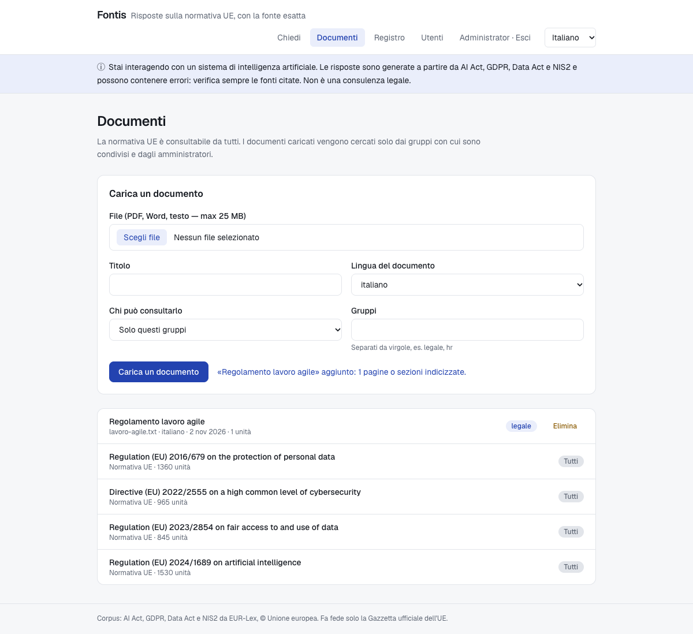
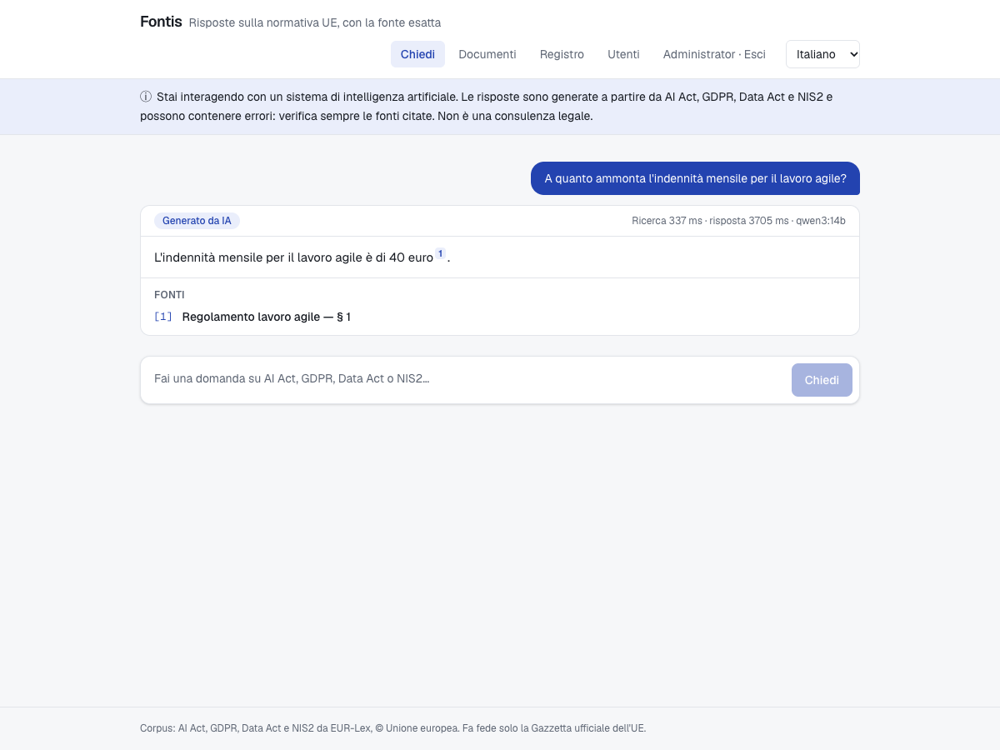

# Documents, users and access

Fontis searches the EU legislation and the organisation's own documents. Who can find what is
decided **inside retrieval**: a document a user may not read never reaches the model.

## Who sees what

| | EU legislation | Document shared with a group | Answer log, users |
|---|:-:|:-:|:-:|
| Anonymous visitor | ✓ | – | – |
| Signed-in user | ✓ | only if in the group | – |
| Administrator | ✓ | ✓ | ✓ |

`DocumentAccess` turns the current user into the list of document ids they may search. Vector and
full-text search both filter on it in SQL. With a selective filter an HNSW index can return fewer
results than asked for; pgvector's iterative index scans (`SET hnsw.iterative_scan = strict_order`,
pgvector ≥ 0.8) keep scanning until enough allowed chunks are found.

The same rule decides what `GET /api/documents` lists.

## Uploading

`POST /api/documents` (administrators), multipart:

| Field | |
|---|---|
| `file` | PDF, Word, ODT, text, Markdown, HTML, RTF — up to 25 MB |
| `title` | defaults to the file name |
| `lang` | `eng`, `ita`, `deu`, `fra`, `spa` — selects the full-text stemmer |
| `visibility` | `RESTRICTED` (default) or `PUBLIC` |
| `groups` | comma-separated group names; missing groups are created |

- **PDF**: one unit per page (Spring AI `PagePdfDocumentReader`), so an answer cites **"p. 12"**.
- **Other formats**: text extracted with Apache Tika (Spring AI `TikaDocumentReader`) and split
  into sections of about 3,000 characters ("§ 3").
- Units are then chunked and embedded by the same `ChunkEmbedder` as the EU corpus.

`DELETE /api/documents/{id}` removes a document with its units and chunks. EU legislation cannot
be deleted.

## Users and sign-in

- Session-based: `POST /api/auth/login` sets a session cookie (a new session id on every login);
  `POST /api/auth/logout`; `GET /api/auth/me`.
- **CSRF**: state-changing requests must send the `XSRF-TOKEN` cookie back in the `X-XSRF-TOKEN`
  header (Spring Security's SPA setup). The web app and the benchmark do this.
- Passwords are hashed with bcrypt (delegating password encoder).
- The first administrator is created at startup from `FONTIS_ADMIN_EMAIL` and
  `FONTIS_ADMIN_PASSWORD` when there are no users yet. Administrators add users and groups on the
  **Users** page or with `POST /api/admin/users`.
- Single sign-on (OpenID Connect, e.g. Microsoft Entra ID) is the next step for company
  deployments.

## Tested

- `SecurityTests`: the answer log is 401 for anonymous visitors and 403 for users; POST without the
  CSRF token is refused; wrong passwords are rejected; only administrators create users.
- `DocumentPermissionTests`: a document shared with `legal` is found by a member of `legal` and by
  an administrator, not by a member of `sales` or an anonymous visitor; PDFs are split into pages;
  deleting a document removes its chunks.
- The browser smoke test (`frontend/e2e/smoke.mjs`) runs the same scenario end to end.

| Uploading, restricted to a group | Answer from the document |
|---|---|
|  |  |
