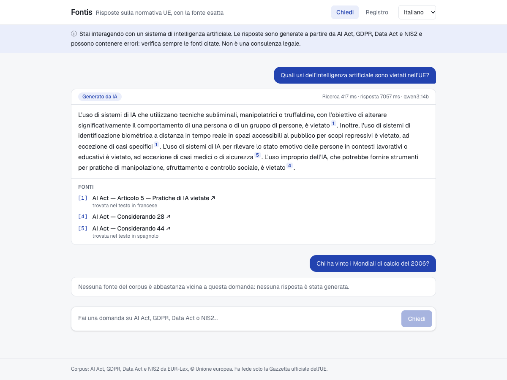
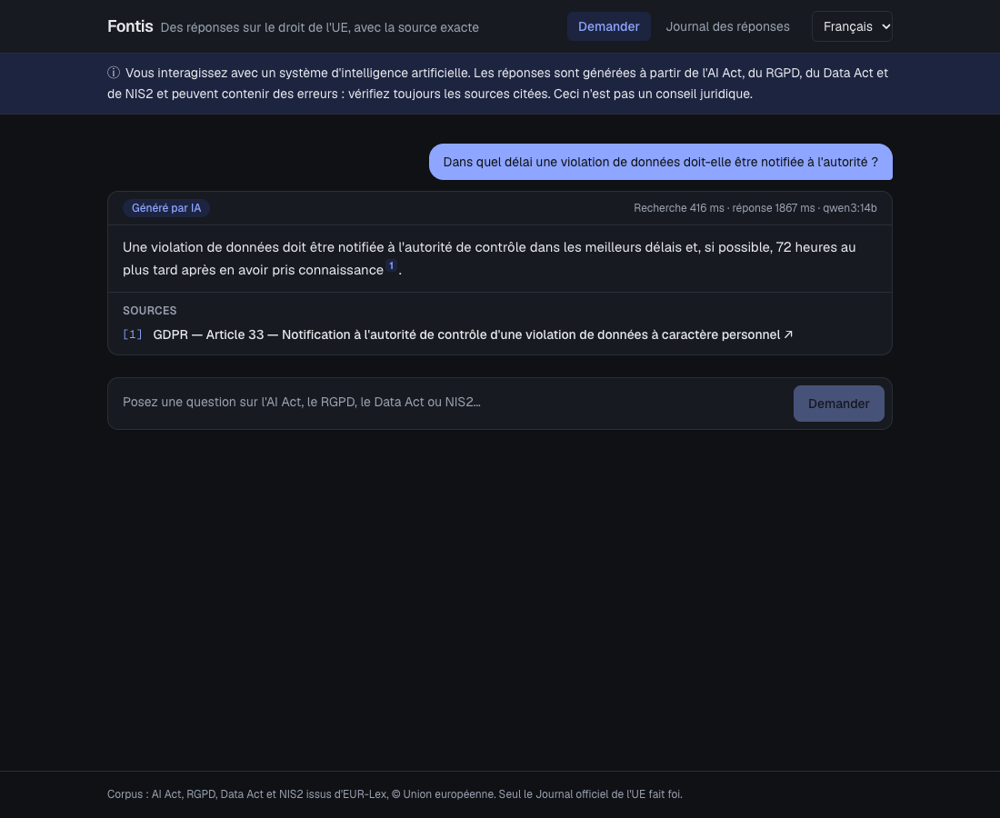
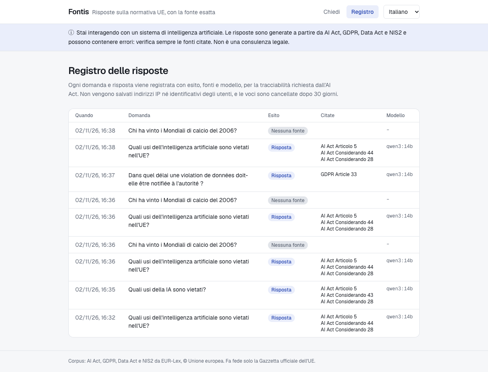

# Transparency and record-keeping

How Fontis meets the transparency expectations of the EU AI Act for an assistant that answers
questions, and how it limits the personal data it keeps.

> This describes design choices, not legal advice. Fontis as a general information tool is not a
> high-risk system under Annex III; a deployment that feeds decisions about people may change that.

## People know they are talking to an AI (AI Act, Art. 50(1))

- A notice under the header of every page, in the user's language: they are interacting with an AI
  system, answers may contain errors, sources must be checked, it is not legal advice.
- Every generated answer carries an **"AI-generated"** label, the model name and its timings.

## Answers can be checked

- Every factual sentence must cite a numbered source; each citation links to the article on
  EUR-Lex, in the user's language.
- When the source was found in another language, the UI says so ("found in the French text").
- When no source supports an answer, the user gets a refusal, not a guess: *no source* (retrieval
  found nothing close enough) or *no answer* (the model found the sources insufficient).
- An answer without citations is flagged as unreliable (`UNCITED`).

## Answer log

Every question is recorded in `answer_log` with its outcome, the cited sources, the model and the
timings, and can be reviewed on the **Answer log** page (`/{locale}/log`, `GET /api/log`).

Because questions may contain personal data:

- **no IP address, user identifier or session** is stored;
- entries are **deleted after 30 days** (`fontis.log.retention-days`) by a nightly job;
- the log page is open in this demo; in week 6, users and permissions will restrict it to
  administrators.

## Sovereignty

- Models run on your own hardware through Ollama (`qwen3:14b`, `bge-m3`); questions and documents
  do not leave the server.
- The browser only talks to the web app, which forwards `/api/*` to the backend.

## Screens

| Italian, light | French, dark |
|---|---|
|  |  |

